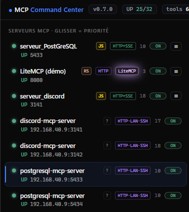
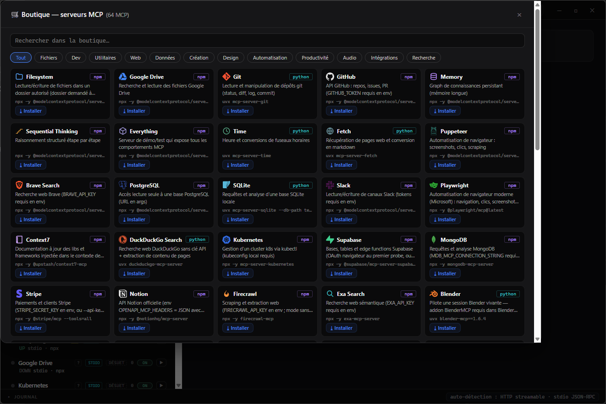

# MCP Command Center

Command center en **Rust natif** (zéro dépendance réseau — std + serde_json uniquement) pour détecter,
superviser et piloter les serveurs **MCP** : HTTP streamable, stdio, et découverte automatique par scan.

 

## Aperçu

<p align="center">
  
</p>
<p align="center"><i>Explorateur — serveurs locaux et distants (SSH), badge framework, glisser-déposer = priorité, version affichée.</i></p>

<p align="center">
  
</p>
<p align="center"><i>Boutique — 64 MCP installables en un clic, logos officiels.</i></p>

## Fonctionnalités principales

| | |
|---|---|
| 🖥️ **Détection sur les autres machines** | Serveurs MCP des **autres ordinateurs du LAN**, **VPS** et **Docker** : scan réseau parallèle, découverte **SSH par clé** (netstat distant + sonde depuis la machine — passe les binds `localhost` et les pare-feux), badges `·LAN·SSH`, import en un clic depuis un pair command-center |
| 🔎 **Détection multi-serveurs** | Scan de plage de ports au boot et à la demande (`::1` + `127.0.0.1`), fingerprint du framework (badge **LiteMCP**), état `UP`/`PORT-ONLY`/`DOWN`, latence, liste des tools, journal temps réel |
| ↔️ **Glisser-déposer** | Réordonne les serveurs dans l'explorateur : **préférence d'affichage et priorité de sondage** (persisté, les serveurs en haut sont interrogés en premier) |
| 🛒 **Boutique intégrée (64 MCP)** | Catalogue officiel + aitmpl + Glama + GitHub, **logos officiels**, installation `npx`/`uvx` en un clic |
| ⏻ **Démarrage auto ON/OFF** | Bouton dans la barre de titre : lance (ou non) l'app au démarrage de l'OS — tray silencieux, serveurs supervisés sans fenêtre (registre Run / autostart XDG / LaunchAgent) |
| 🏷️ **Version visible** | Badge `v0.7.1` permanent + vérification de mise à jour GitHub (badge ambre « ⬆ vX dispo » si une release plus récente existe) |

> **Écosystème** : les serveurs écrits avec [**LiteMCP**](https://github.com/DeamonDev888/litemcp) — la lib MCP
> stateless en Rust ([crates.io](https://crates.io/crates/litemcp)) — sont détectés et badgés nativement
> par fingerprint (version non négociée + sonde `/health`).

## Lancer

```
start-command-center.bat
```
→ UI sur **http://127.0.0.1:5090** (passe au port suivant si occupé par un logiciel étranger, jusqu'à +9).

> **Instance unique (v0.7.2)** : si un moteur command-center tourne déjà (desktop ou
> headless, en arrière-plan), un nouveau lancement **s'y reconnecte** au lieu d'en
> lancer un second — un seul processus supervise les serveurs. Le journal complet
> vit dans `mcc.log` (à côté du config.json) même quand rien n'est affiché à l'écran.

> **Sécurité (v0.7.4)** : le bind par défaut est `127.0.0.1` (UI locale seulement).
> **Aucun code n'est jamais demandé pour l'usage local** (fenêtre desktop, navigateur de
> la machine), même en bind LAN. Si l'UI est ouverte au LAN (`"ui_bind": "0.0.0.0"`), un
> code d'accès est exigé des clients du **réseau** sur `/api/*` — généré au premier boot
> et persisté dans `settings.api_access` (ou via `MCC_API_ACCESS`), jamais envoyé dans la
> page. Les **pairs** command-center prouvent qu'ils connaissent le code sans le
> transmettre (`GET /api/hello` → nonce à usage unique, puis `X-MCC-Proof` =
> HMAC-SHA256 du nonce avec le code — même valeur des deux côtés). CSP stricte sur la
> page, contrôles Host/Origin sur toutes les connexions.

## Ce que ça fait

| Fonction | Détail |
|---|---|
| Détection HTTP | `initialize` + `tools/list` JSON-RPC sur `POST /mcp` — sonde **`::1` ET `127.0.0.1`** (les serveurs FastMCP locaux bindent en IPv6-only). Fingerprint du **framework** : « LiteMCP » quand l'initialize est répondu en 2026-07-28 sans négocier **et** que `GET /health` répond « ok » (badge violet « glow » dans l'UI, langage Rust par déduction) |
| Détection stdio | spawn + handshake JSON-RPC ligne-par-ligne sur stdin/stdout, liste les tools, maintient le process |
| Découverte auto | scan de plage de ports au boot (3000-3200 par défaut) + à la demande — tout port qui répond `initialize` avec un `serverInfo` est ajouté |
| 3 états | `UP` (MCP répond), `PORT-ONLY` (port bound mais pas de MCP = zombie), `DOWN` — le piège classique du moniteur binaire |
| Pilote Start/Stop | lance/arrête les serveurs stdio **et** les HTTP/HTTPS avec commande de lancement (auto-restart au boot/crash par flag `auto_restart`) |
| Persistance | `config.json` (serveurs + réglages), rechargé et re-sondé au démarrage |
| UI web | embarquée dans le binaire : cartes par serveur, état, latence, host de bind, version, protocole, liste des tools, journal temps réel |

## État actuel sur cette machine (vérifié)

7 seeds pré-chargés depuis l'écosystème launcher existant :

| Serveur | Port | État | Détecté |
|---|---|---|---|
| Overmind | 3099 | UP | OverMind-MCP v3.10.5 — 16 tools, ~1-2 ms |
| serveur_discord | 3141 | UP | discord-mcp-server v2.1.3 — 18 tools |
| serveur_PostGreSQL | 5433 | UP | postgresql-mcp-server v1.0.0 — 10 tools |
| X | 3142 | UP | x-mcp-server v1.0.0 — 15 tools |
| debats | 3100 | DOWN | désactivé (launcher) |
| NEWS_BTC | 3143 | DOWN | désactivé (launcher) |
| NEWS | 3144 | DOWN | désactivé (launcher) |
| LiteMCP (démo) | 8080 | UP | litemcp hello v0.1.0 — 3 tools, badge « LiteMCP » (fingerprint framework) |

+ tout ce qui est ajouté/manuellement ou découvert par scan (persisté dans `config.json`).

## Couches réseau par stack

Le command center (colonne Rust std) parle HTTP/1.1 **à la main** : `TcpStream` brut + parseur de
réponses maison (Content-Length + chunked), pas de dépendance réseau. Vue comparée :

| Couche | Rust std | Node (TS serveur) | Navigateur | Python |
|---|---|---|---|---|
| TCP brut | `TcpStream` | `node:net` | ✗ interdit | `socket` |
| TLS | ✗ → rustls | ✅ `node:tls` | ✅ intégré | ✅ `ssl` |
| HTTP/1.1 | à la main | ✅ `node:http` | `fetch` | ✅ `http.client` |
| SSE | à la main | ✅ réponse chunked | ✅ `EventSource` | à la main (`http.client`) → `httpx`/`aiohttp-sse` |
| WebSocket | `tungstenite` | package `ws` | ✅ natif | `websockets` / `websocket-client` (externes) |
| HTTP/2 | `h2` | ✅ `node:http2` | `fetch` (négocié) | `httpx[h2]` (h2/hyper, externe) |
| HTTP/3 / QUIC | `quinn` | ✗ core (crates externes) | WebTransport (partiel) | `aioquic` (externe) |
| Async | Future sans exécuteur | ✅ event loop native | ✅ native | `asyncio` (stdlib) |

## API (pour scripts)

> Hors loopback, chaque appel `/api/*` doit porter le code d'accès : en-tête
> `X-MCC-Access: <code>` (ou `?access=<code>`). `POST /api/action` exige
> `Content-Type: application/json`.

```
GET  /api/state                 état complet + journal
GET  /api/detail?id=<id>        détail d'un serveur (liste tools complète)
POST /api/action                {"action":"refresh|toggle|scan|add|remove|start|kill|start_stdio|kill_stdio", ...}
```

Exemples :
```bash
curl -X POST -H "Content-Type: application/json" \
  -d '{"action":"scan","from":3000,"to":3200}' http://127.0.0.1:5090/api/action

curl -X POST -H "Content-Type: application/json" \
  -d '{"action":"add","transport":"stdio","label":"mon-mcp","program":"node","args":["dist/index.js"]}' \
  http://127.0.0.1:5090/api/action
```

## Fixtures de test

`examples/test-stdio-server.js` et `examples/test-http-server.js` : deux serveurs MCP factices
(zéro dépendance node) pour tester stdio et découverte HTTP sans toucher aux vrais serveurs.

## Limites connues

- Découverte = probe `/mcp` sur chaque port ouvert (pas de mDNS/DNS-SD, pas de SSDP).
- `config.json` vit dans le dossier du projet (chemin figé à la compilation via `CARGO_MANIFEST_DIR`).
## Feuille de route (audit v0.5.1)

### À construire
| # | Item | Priorité |
|---|---|---|
| 1 | Auth token sur l'API (/api/* quand bind 0.0.0.0) | P0 |
| 2 | Export/Import complet de config (partage entre machines) | P1 |
| 3 | tools/call depuis l'UI (exécuter un tool et voir le résultat) | P1 |
| 4 | WebSocket/SSE live (remplace le polling 5 s) | P1 |
| 5 | persistance des serveurs découverts (opt-in) | P2 |
| 6 | Mode service Windows (démarrage auto, pas de console) | P2 |
| 7 | Vrai shell Electron/Tauri (alternative au mode --app) | P2 |
| 8 | tools/call + ressources/prompts MCP (au-delà des tools) | P2 |
| 9 | Historique des états (grafana-like) | P3 |
| 10 | i18n EN | P3 |

### À optimiser
| # | Item | Gain |
|---|---|---|
| 1 | scan_ports parallélisé (actuellement ~6 s/200 ports en séquentiel 150 ms/port) | x10 |
| 2 | Mutex globaux → granulaires (contension sous scans + polls simultanés) | réactivité |
| 3 | Cache tool list (re-sonder seulement si ETag/hash change) | réseau |
| 4 | Timeout handshake stdio configurable par serveur | UX |
| 5 | Connection pooling HTTP (réutiliser les sockets du poll) | latence |

### Sécurité (état v0.7.1 — audit 2026-10-24 traité)
- Code d'accès API obligatoire hors loopback (généré au boot, persisté), bind par défaut `127.0.0.1`, et **jamais exposé par la page `/`** : dialogue de déverrouillage UI + `localStorage` (v0.6.6 l'injectait dans la page — quiconque joint le port le lisait).
- Pairs command-center authentifiés **par preuve, pas par secret** : `GET /api/hello` (nonce à usage unique) puis `X-MCC-Proof` = HMAC-SHA256 du nonce avec le code (`crypto.rs`, std pur, vecteurs NIST/RFC testés) — plus aucun envoi du code en clair sur le LAN.
- Anti CSRF / DNS-rebinding : `OPTIONS` 403, `Host`/`Origin` filtrés, `Content-Type: application/json` exigé sur `/api/action`, ACAO reflétée uniquement pour les origines autorisées.
- Page UI servie avec **CSP stricte** + `nosniff` ; capability desktop restreinte aux ports 5090-5099.
- Caps mémoire des deux côtés : requêtes entrantes (2 Mo, 64 connexions) **et réponses des sondes sortantes** (2 Mo / 256 Ko).
- `kill_port` par colonne exacte et porté sur Linux/macOS (`ss -tlnp` + `lsof`), imports `claude mcp add` bornés (plus de panic), vérification de mise à jour via `curl` sur les trois OS.
- Reste à faire : rate-limit fin sur `/api/action` ; les installs boutique exécutent npx/uvx sans sandbox (le dossier de Filesystem est demandé explicitement).

