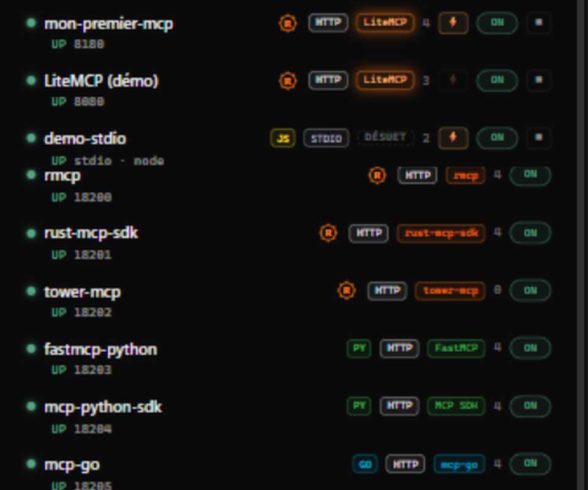

# MCP Control

Une petite application qui **veille sur tes serveurs MCP** : elle les trouve toute seule, te dit lequel marche et lequel est cassé, et te laisse tout allumer ou éteindre d'un clic.


## Ça sert à quoi ?

- **Voir** tous tes serveurs MCP en un coup d'œil (même ceux que tu avais oubliés).
- **Savoir** immédiatement qui marche et qui est planté.
- **Agir** : démarrer, arrêter, installer de nouveaux serveurs, tout depuis la même fenêtre.

## Installer

Télécharge **`mcp-control-desktop-windows-x86_64-setup.exe`** depuis la
[dernière release](https://github.com/DeamonDev888/mcp-control/releases/latest)
et lance-le : un assistant t'accompagne (langue, dossier d'installation, dossier
du menu Démarrer, raccourci bureau). Aucun droit administrateur n'est demandé.

Tu peux aussi utiliser le `.exe` portable, sans installation, ou
`start-mcp-control.bat` si tu as le dépôt.

## Démarrer

1. Ouvre l'app (raccourci du bureau ou du menu Démarrer).
2. La fenêtre s'ouvre. **C'est tout** — la liste se remplit toute seule.

## Lire l'écran : les 4 états, ce qu'ils veulent dire

L'app ne se contente pas de dire « ça marche / ça marche pas ». Chaque serveur
a un **état fin**, et l'état dit *pourquoi* il est dans cet état.

### 🟢 UP — le serveur répond vraiment

Le handshake MCP complet a réussi : `initialize` puis `tools/list` ont reçu des
réponses valides, et l'app connaît **le nombre d'outils** du serveur.

*Exemple concret* — un serveur LiteMCP sur le port 8787 :

```
moltbook          [RS] [HTTP] [LiteMCP]        UP  127.0.0.1:8787 · 27 tools · 1 ms
```

- `RS` = écrit en Rust, `HTTP` = transport HTTP, `LiteMCP` = framework détecté
- `27 tools` = le serveur a vraiment listé 27 outils
- `1 ms` = latence mesurée

C'est le seul état où le serveur est **utilisable** par un client MCP.

### 🟠 PORT-ONLY — le port répond, le serveur MCP ne répond pas

C'est l'état le plus important à comprendre : **le port est ouvert** (un
process y écoute), mais ce processus **ne parle pas MCP**. Souvent ce n'est pas
un serveur MCP du tout : une API REST, un autre service, un proxy…

*Exemple concret* — un service HTTP qui n'est pas un serveur MCP :

```
mon-api           [JS] [HTTP]                   PORT-ONLY  127.0.0.1:32100
```

Le port 32100 répond (`200 OK`) mais le handshake MCP échoue — l'app affiche
donc PORT-ONLY, et non UP. Le champ « erreur » du détail donne le motif exact.

L'app l'affiche en orange pour que tu ne la croies pas morte : **le port est
encore pris : une vraie erreur de sortie (« port déjà utilisé ») arrivera
au prochain démarrage. En pratique : soit le serveur a planté en laissant un
process fils, soit ce port n'a jamais porté de serveur MCP.

### ⚪ DOWN — le serveur est éteint

Le port est fermé : rien n'écoute. C'est l'état normal d'un serveur arrêté,
ou d'un serveur qui n'a pas encore été lancé.

*Exemple concret* — un serveur stdio dont le process n'est pas démarré :

```
Filesystem        [JS] [STDIO] désuet           DOWN  stdio · npx
```

Différence avec PORT-ONLY : ici **le port est libre**. Le serveur peut être
redémarré sans rien éteindre d'abord (bouton **▶** s'il a une commande de
lancement connue, sinon le champ « commande de lancement » dans son détail).

### ⚫ DISABLED — tu l'as mis en pause toi-même

Le serveur est **volontairement** hors supervision : l'app ne le sonde plus,
ne le relance pas, et ne compte pas ses outils. Il reste visible dans la
liste (pour ne pas l'oublier) avec l'interrupteur **OFF**.

*Exemple concret* — un serveur mis en pause pendant une migration :

```
debats            [JS] [HTTP]                   DISABLED  127.0.0.1:3140
```

Tu le relances d'un clic (**▶ Reprendre**) dans son détail, ou en remettant
l'interrupteur **ON** dans la liste.

### En résumé

| État | Le port | Le serveur MCP | Cause habituelle | quoi faire |
|---|---|---|---|---|
| 🟢 **UP** | ouvert | répond | — | rien, tout va bien |
| 🟠 **PORT-ONLY** | **ouvert** | ne répond pas | autre service sur le port, process fils resté | identifier le occupant du port, ou retirer le serveur |
| ⚪ **DOWN** | fermé | ne répond pas | serveur arrêté / planté | **▶** pour le relancer |
| ⚫ **DISABLED** | — | — | **mis en pause par toi** | **▶ Reprendre** |

### Reproduire les 4 états chez soi

```bash
# UP — un vrai serveur MCP sur le port
node examples/test-http-server.js 3166

# PORT-ONLY — un port qui répond mais n'est pas MCP
node -e "require('http').createServer((q,s)=>s.end('ok')).listen(32100)"

# DOWN — un port fermé (rien n'écoute)
#   → ajoute un serveur sur le port 32101 et ne le démarre pas

# DISABLED — clique sur ⏸ « Mettre en pause » dans la liste
```

> **Pourquoi cette précision ?** Parce que « ça ne marche pas » ne dit rien
> d'utile. PORT-ONLY et DOWN n'appellent pas le même geste : le premier se
> répare en identifiant qui occupe le port, le second se relance.

Les petits badges à côté du nom (`FastMCP`, `LiteMCP`, `rmcp`, `mcp-go`, `Spring AI`…)
indiquent **avec quoi le serveur est construit** — **37 frameworks reconnus**, du Python
au PHP, avec leur langage. Le badge `STDIO` / `HTTP` / `WS` indique le transport.

👉 La liste complète des 37 frameworks : **[docs/frameworks.md](docs/frameworks.md)**


*Trois familles, trois codes couleur. **Langage** (à gauche) : la couleur du langage — JS jaune, Python vert, Rust orange, Go cyan. **Transport** : monochrome — `HTTP` le plus clair, `STDIO` médian, `WS` le plus sourd — et le chip `désuet` en pointillés pour les serveurs stdio. **Framework** (à droite) : la couleur du langage qu'il fait tourner ; seul **LiteMCP** porte un halo orange.*


*Clique sur un serveur : tu vois tous ses outils (tools), son état, sa vitesse, sa version — et des boutons pour l'allumer, l'éteindre, ou couper un outil précis.*


*Un serveur Rust affiche son logo 🦀 (le « R » cerclé). Ici l'app a aussi reconnu le framework LiteMCP.*

## Les boutons

| Bouton | Ce qu'il fait |
|---|---|
| **⟳** | Rafraîchit tout et cherche les nouveaux serveurs |
| **🔍 Scan ports** | Cherche des serveurs sur une plage de ports |
| **🌐 Scan réseau** | Cherche des serveurs sur les autres PC du réseau |
| **🖥️ Machines** | Va chercher les serveurs d'une autre machine (VPS, serveur…) via SSH |
| **🛒 Boutique** | 64 serveurs MCP prêts à installer en 1 clic |
| **+ Ajouter** | Ajouter un serveur à la main |
| **ON/OFF** | Allumer / éteindre un serveur |
| **▶ / ■** | Démarrer / arrêter le programme du serveur |
| **⚡** | **Autoboot du serveur** : le relancer automatiquement au démarrage de l'app et après un crash |
| **⏸ Mettre en pause** | Retire le serveur de la supervision (il reste dans la liste, réactivable) |
| **🗑 Supprimer** | Enlève le serveur de la liste |
| **⇅** | Ranger la liste (A→Z, état, rapidité…) — ou glisse une ligne à la main |
| **⏭ Auto-boot** (barre du haut) | Ouvrir l'app elle-même au démarrage de Windows |


*64 serveurs MCP à installer d'un clic, avec leurs logos. Une barre de recherche pour trouver le bon.*

## Un problème ? La réponse rapide

| Problème | Solution |
|---|---|
| Mon serveur n'apparaît pas | Clique **⟳**. Sinon : **+ Ajouter** avec son numéro de port |
| « Code d'accès » demandé | Ça n'arrive JAMAIS sur ton PC — seulement si tu ouvres l'app depuis une autre machine. Le code est dans `config.json` |
| L'app ne s'ouvre plus | Elle est peut-être déjà dans la zone de notification (près de l'horloge) — clique sur son icône |
| Où voir l'historique ? | Barre « Journal » en bas de la fenêtre — clique dessus pour la déplier |
| Un serveur ne redémarre pas | Après 3 échecs, l'app arrête d'insister. Clique **▶** pour réessayer |
| Tous mes serveurs distants sont DOWN | Un **VPN** coupe souvent le réseau local : un bandeau rouge s'affiche en haut. Déconnecte-le ou active « autoriser les connexions LAN » |
| Mes serveurs ont disparu de la liste | Ils ont peut-être été mis **en pause** (⚪ DISABLED) : clique **▶ Reprendre** dans leur détail |

## Pour aller plus loin

<details>
<summary><b>Commander l'app depuis un script (avancé)</b></summary>

```bash
# tout l'état
curl http://127.0.0.1:5090/api/state

# détail d'un serveur
curl "http://127.0.0.1:5090/api/detail?id=seed-overmind"

# une action (refresh, toggle, scan, add, remove, start, kill…)
curl -X POST -H "Content-Type: application/json" \
  -d '{"action":"add","transport":"stdio","label":"mon-mcp","program":"node","args":["dist/index.js"]}' \
  http://127.0.0.1:5090/api/action
```

</details>

<details>
<summary><b>Sécurité (avancé)</b></summary>

- Par défaut, l'app n'est joignable que depuis ton PC — rien n'est ouvert vers l'extérieur.
- Si tu l'ouvres au réseau (d'autres machines), un code d'accès est exigé d'elles automatiquement.
- L'app vérifie les origines des connexions et plafonne la taille des requêtes.

</details>

<details>
<summary><b>Compiler soi-même (avancé)</b></summary>

```bash
cargo build --release -p mcp-control -p mcp-control-desktop
cargo test      # 75 tests
```

- `start-mcp-control.bat` → la fenêtre de l'app
- `start-headless.bat` → juste le moteur, sans fenêtre
- Les serveurs écrits avec [LiteMCP](https://github.com/DeamonDev888/litemcp) (lib Rust) sont reconnus automatiquement.

</details>

## Limites

- Un serveur en `https://` n'est pas sondable (pas de TLS) — passe par un tunnel local.
- Le fichier `config.json` vit à côté de l'exe.
