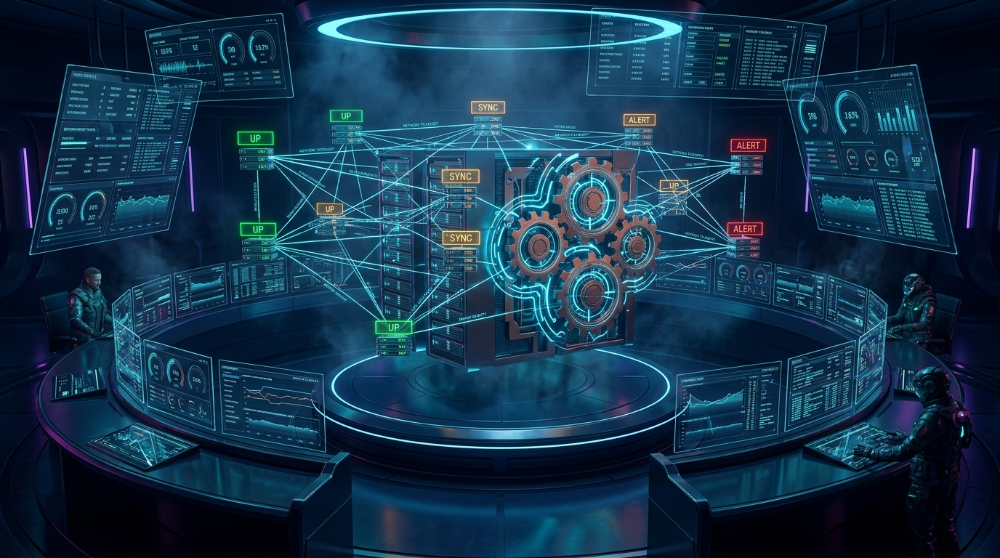

# MCP Command Center

<p align="center">
  
</p>

Command center en **Rust natif** (zéro dépendance réseau — std + serde_json uniquement) pour détecter,
superviser et piloter les serveurs **MCP** : HTTP streamable, stdio, et découverte automatique par scan.

 

## Lancer

```
start-command-center.bat
```
→ UI sur **http://127.0.0.1:5090** (passe au port suivant si occupé, jusqu'à +9).

## Ce que ça fait

| Fonction | Détail |
|---|---|
| Détection HTTP | `initialize` + `tools/list` JSON-RPC sur `POST /mcp` — sonde **`::1` ET `127.0.0.1`** (les serveurs FastMCP locaux bindent en IPv6-only) |
| Détection stdio | spawn + handshake JSON-RPC ligne-par-ligne sur stdin/stdout, liste les tools, maintient le process |
| Découverte auto | scan de plage de ports au boot (3000-3200 par défaut) + à la demande — tout port qui répond `initialize` avec un `serverInfo` est ajouté |
| 3 états | `UP` (MCP répond), `PORT-ONLY` (port bound mais pas de MCP = zombie), `DOWN` — le piège classique du moniteur binaire |
| Pilote stdio | Start/Stop manuels + auto-restart au boot et au crash (configuré par flag `auto_restart`) |
| Persistance | `config.json` (serveurs + réglages), rechargé et re-sondé au démarrage |
| UI web | embarquée dans le binaire : cartes par serveur, état, latence, host de bind, version, protocole, liste des tools, journal temps réel |

## État actuel sur cette machine (vérifié)

7 seeds pré-chargés depuis l'écosystème launcher existant :

| Serveur | Port | État | Détecté |
|---|---|---|---|
| Overmind | 3099 | UP | OverMind-MCP v3.10.5 — 16 tools, ~1-2 ms |
| serveur_discord | 3141 | UP | discord-mcp-server v2.1.3 — 18 tools |
| serveur_PostGreSQL | 5433 | UP | postgresql-mcp-server v1.0.0 — 10 tools |
| X | 3142 | UP | x-mcp-server v1.0.0 — 15 tools |
| debats | 3100 | DOWN | désactivé (launcher) |
| NEWS_BTC | 3143 | DOWN | désactivé (launcher) |
| NEWS | 3144 | DOWN | désactivé (launcher) |

+ tout ce qui est ajouté/manuellement ou découvert par scan (persisté dans `config.json`).

## API (pour scripts)

```
GET  /api/state                 état complet + journal
GET  /api/detail?id=<id>        détail d'un serveur (liste tools complète)
POST /api/action                {"action":"refresh|toggle|scan|add|remove|start_stdio|kill_stdio", ...}
```

Exemples :
```bash
curl -X POST -H "Content-Type: application/json" \
  -d '{"action":"scan","from":3000,"to":3200}' http://127.0.0.1:5090/api/action

curl -X POST -H "Content-Type: application/json" \
  -d '{"action":"add","transport":"stdio","label":"mon-mcp","program":"node","args":["dist/index.js"]}' \
  http://127.0.0.1:5090/api/action
```

## Fixtures de test

`examples/test-stdio-server.js` et `examples/test-http-server.js` : deux serveurs MCP factices
(zéro dépendance node) pour tester stdio et découverte HTTP sans toucher aux vrais serveurs.

## Limites connues (v0.1)

- Découverte = probe `/mcp` sur chaque port ouvert (pas de mDNS/DNS-SD, pas de SSDP).
- Le scan sonde séquentiellement avec timeout 150 ms/port → une plage 3000-3200 prend ~25-60 s.
- `config.json` vit dans le dossier du projet (chemin figé à la compilation via `CARGO_MANIFEST_DIR`).
