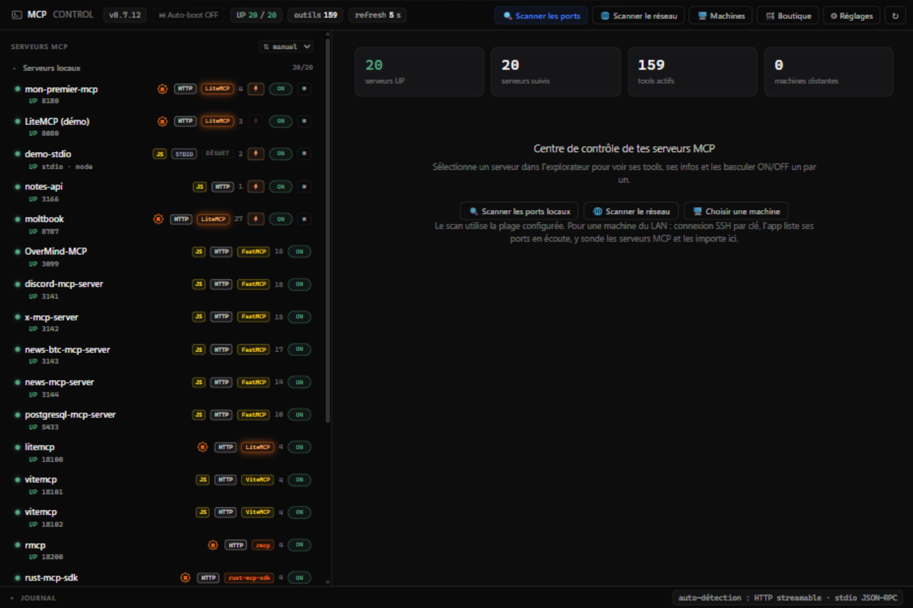
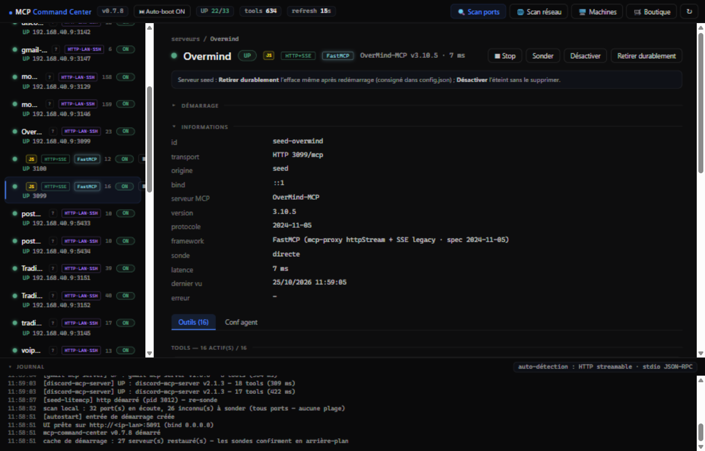
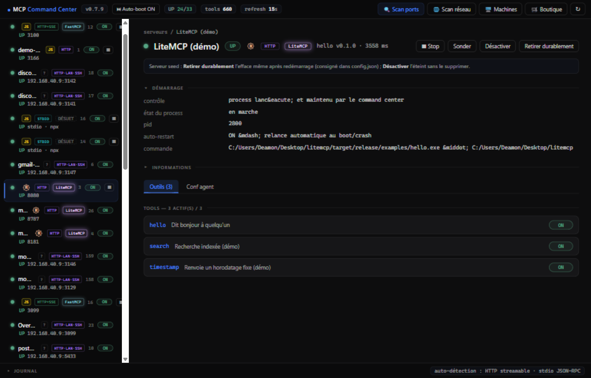
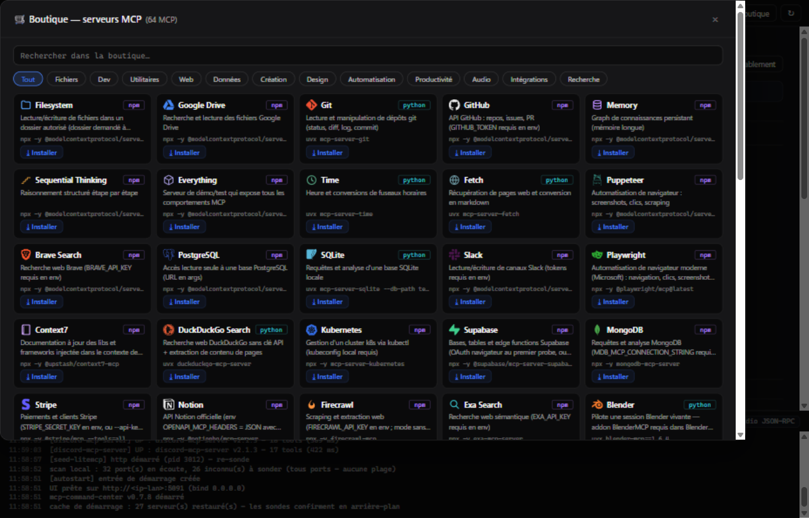

# MCP Command Center

Une petite application qui **veille sur tes serveurs MCP** : elle les trouve toute seule, te dit lequel marche et lequel est cassé, et te laisse tout allumer ou éteindre d'un clic.



## Ça sert à quoi ?

- **Voir** tous tes serveurs MCP en un coup d'œil (même ceux que tu avais oubliés).
- **Savoir** immédiatement qui marche et qui est planté.
- **Agir** : démarrer, arrêter, installer de nouveaux serveurs, tout depuis la même fenêtre.

## Installer

Télécharge **`mcp-command-center-desktop-windows-x86_64-setup.exe`** depuis la
[dernière release](https://github.com/DeamonDev888/mcp-command-center/releases/latest)
et lance-le : un assistant t'accompagne (langue, dossier d'installation, dossier
du menu Démarrer, raccourci bureau). Aucun droit administrateur n'est demandé.

Tu peux aussi utiliser le `.exe` portable, sans installation, ou
`start-command-center.bat` si tu as le dépôt.

## Démarrer

1. Ouvre l'app (raccourci du bureau ou du menu Démarrer).
2. La fenêtre s'ouvre. **C'est tout** — la liste se remplit toute seule.

## Lire l'écran

| Tu vois | Ça veut dire |
|---|---|
| 🟢 **UP** | Le serveur marche |
| 🟠 **PORT-ONLY** | Le serveur est planté (le port répond, mais pas le serveur) |
| ⚪ **DOWN** | Le serveur est éteint |
| ⚫ **DISABLED** | Tu l'as désactivé toi-même |

Les petits badges à côté du nom (`FastMCP`, `LiteMCP`, `rmcp`, `mcp-go`, `Spring AI`…) indiquent **avec quoi le serveur est construit** — 37 frameworks reconnus, du Python au PHP, avec leur langage. Le badge `STDIO` / `HTTP` / `WS` indique le transport.


*Clique sur un serveur : tu vois tous ses outils (tools), son état, sa vitesse, sa version — et des boutons pour l'allumer, l'éteindre, ou couper un outil précis.*


*Un serveur Rust affiche son logo 🦀 (le « R » cerclé). Ici l'app a aussi reconnu le framework LiteMCP.*

## Les boutons

| Bouton | Ce qu'il fait |
|---|---|
| **⟳** | Rafraîchit tout et cherche les nouveaux serveurs |
| **🔍 Scan ports** | Cherche des serveurs sur une plage de ports |
| **🌐 Scan réseau** | Cherche des serveurs sur les autres PC du réseau |
| **🖥️ Machines** | Va chercher les serveurs d'une autre machine (VPS, serveur…) via SSH |
| **🛒 Boutique** | 64 serveurs MCP prêts à installer en 1 clic |
| **+ Ajouter** | Ajouter un serveur à la main |
| **ON/OFF** | Allumer / éteindre un serveur |
| **▶ / ■** | Démarrer / arrêter le programme du serveur |
| **⚡** | **Autoboot du serveur** : le relancer automatiquement au démarrage de l'app et après un crash |
| **⏸ Mettre en pause** | Retire le serveur de la supervision (il reste dans la liste, réactivable) |
| **🗑 Supprimer** | Enlève le serveur de la liste |
| **⇅** | Ranger la liste (A→Z, état, rapidité…) — ou glisse une ligne à la main |
| **⏭ Auto-boot** (barre du haut) | Ouvrir l'app elle-même au démarrage de Windows |


*64 serveurs MCP à installer d'un clic, avec leurs logos. Une barre de recherche pour trouver le bon.*

## Un problème ? La réponse rapide

| Problème | Solution |
|---|---|
| Mon serveur n'apparaît pas | Clique **⟳**. Sinon : **+ Ajouter** avec son numéro de port |
| « Code d'accès » demandé | Ça n'arrive JAMAIS sur ton PC — seulement si tu ouvres l'app depuis une autre machine. Le code est dans `config.json` |
| L'app ne s'ouvre plus | Elle est peut-être déjà dans la zone de notification (près de l'horloge) — clique sur son icône |
| Où voir l'historique ? | Barre « Journal » en bas de la fenêtre — clique dessus pour la déplier |
| Un serveur ne redémarre pas | Après 3 échecs, l'app arrête d'insister. Clique **▶** pour réessayer |
| Tous mes serveurs distants sont DOWN | Un **VPN** coupe souvent le réseau local : un bandeau rouge s'affiche en haut. Déconnecte-le ou active « autoriser les connexions LAN » |
| Mes serveurs ont disparu de la liste | Ils ont peut-être été mis **en pause** (⚪ DISABLED) : clique **▶ Reprendre** dans leur détail |

## Pour aller plus loin

<details>
<summary><b>Commander l'app depuis un script (avancé)</b></summary>

```bash
# tout l'état
curl http://127.0.0.1:5090/api/state

# détail d'un serveur
curl "http://127.0.0.1:5090/api/detail?id=seed-overmind"

# une action (refresh, toggle, scan, add, remove, start, kill…)
curl -X POST -H "Content-Type: application/json" \
  -d '{"action":"add","transport":"stdio","label":"mon-mcp","program":"node","args":["dist/index.js"]}' \
  http://127.0.0.1:5090/api/action
```

</details>

<details>
<summary><b>Sécurité (avancé)</b></summary>

- Par défaut, l'app n'est joignable que depuis ton PC — rien n'est ouvert vers l'extérieur.
- Si tu l'ouvres au réseau (d'autres machines), un code d'accès est exigé d'elles automatiquement.
- L'app vérifie les origines des connexions et plafonne la taille des requêtes.

</details>

<details>
<summary><b>Compiler soi-même (avancé)</b></summary>

```bash
cargo build --release -p mcp-command-center -p mcp-command-center-desktop
cargo test      # 75 tests
```

- `start-command-center.bat` → la fenêtre de l'app
- `start-headless.bat` → juste le moteur, sans fenêtre
- Les serveurs écrits avec [LiteMCP](https://github.com/DeamonDev888/litemcp) (lib Rust) sont reconnus automatiquement.

</details>

## Limites

- Un serveur en `https://` n'est pas sondable (pas de TLS) — passe par un tunnel local.
- Le fichier `config.json` vit à côté de l'exe.
